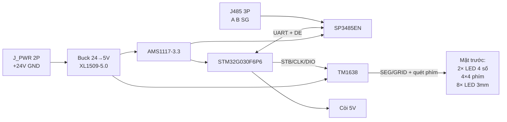

# Sơ đồ nguyên lý — Panel Keyboard RS485 (rev C, cấu hình thương mại)

Rev C dùng linh kiện phổ biến ở cửa hàng VN và trên LCSC: **STM32G030F6P6**, **TM1638**, **SP3485EN (JLC Basic C8963)**, **XL1509-5.0 (SOP-8)**, **AMS1117-3.3**, 2 module LED 4 số 0,56", còi chủ động 12 mm. Schematic sinh bằng `hardware/kicad/panel-keyboard/tools/build_schematic.py`.

## 1. Khối hệ thống



## 2. Bố trí PCB

- **Mặt trên:** toàn bộ chip và SMD (stencil một lần) + còi BZ1 (chân cắm). **Mặt dưới:** 2 module LED 4 số, 16 phím, 8 LED 3 mm.
- Cột phải: nguồn ở trên, MCU + TM1638 + RS485 ở dưới. Chi tiết: `PCB_LAYOUT.md`.

## 3. Nguồn (24 V tủ điện)

```
J_PWR +24V ── F1 PPTC 1812 0,5A/33V ── FBIN ferrite 0805 ── VIN_PROTECT
VIN_PROTECT: TVS1 SMAJ28CA || C19 2,2µF/50V || C15 100nF ── DREV SS34 (chống ngược cực) ── +24V
+24V: C4 470µF/35V, C16 2,2µF/50V + C17 100nF sát chân VIN U4

U4 XL1509-5.0 (SOP-8): 1 VIN, 2 OUT (SW), 3 FB → +5V_RAW (bản 5.0 cố định, không chia áp),
   4 ~EN → GND_PWR (mức thấp = chạy), 5–8 GND_PWR
D8 SS34 (SW → GND_PWR), L1 47µH cỡ 6045 → +5V_RAW (C2 220µF/10V + C5) ── FB2 ── +5V (C22 220µF) ── FB5V → +5V_LED

GND_PWR ── NT1 ── GND (logic)
+5V ── U5 AMS1117-3.3 ── +3V3_LDO (C3 22µF + C18 100nF) ── FB1 ── +3V3
```

| Net | Mô tả |
|-----|--------|
| `+24V_IN` / `+24V_FUSE` | Tủ → F1 → FBIN |
| `VIN_PROTECT` | Sau ferrite, có TVS |
| `+24V` | Sau diode chống ngược, vào buck |
| `GND_PWR` | Return 24 V / switching (star qua NT1) |
| `GND` | Logic / MCU / RS485 |
| `+5V` / `+5V_LED` | Còi, bias RS485 / TM1638 + LED |
| `+3V3` | STM32, SP3485EN |

Dòng tải 5 V ước tính ≤ 300 mA (LED quét + còi + logic) → dòng vào 24 V ≈ 80 mA. Diode SS34 chống ngược sụt ~0,4 V, tổn hao < 0,05 W.

## 4. STM32G030F6P6 (TSSOP-20)

| Chức năng | Chân | GPIO | Ghi chú |
|-----------|------|------|---------|
| VDD / VSS | 4 / 5 | | CVDD1 100nF sát chân |
| NRST | 6 | | pull-up nội + CNRST 100nF |
| DE | 8 | PA1 | RDE 10k kéo xuống (mặc định RX) |
| TX / RX | 9 / 10 | PA2 / PA3 | USART2, 47 Ω nối tiếp |
| TM_STB / TM_CLK / TM_DIO | 11 / 12 / 13 | PA4 / PA5 / PA6 | **open-drain**, kéo lên +5V_LED 4,7k (chân FT chịu 5 V; VIH TM1638 ≈ 0,7·VDD) |
| BZ_ON | 14 | PA7 | bật còi |
| LOG_TX / LOG_RX | 20 / 1 | PB6 / PB7 | USART1, giắc J_LOG (DAPLink) |
| SWDIO / SWCLK | 18 / 19 | PA13 / PA14 | PA14 cũng là BOOT0 (pull-down nội) |

Chân 2, 3, 7, 15, 16, 17 để trống (dự phòng).

## 5. TM1638 — hiển thị, LED trạng thái, quét phím

| Chân TM1638 | Net | Nối tới |
|-------------|-----|---------|
| 5–12 SEG1/KS1–SEG8/KS8 | SEG1–SEG8 | đoạn a, b, c, d, e, f, g, dp của 2 module + chân phím |
| 13 SEG9 | LED_ROW | anode chung D10–D17 |
| 24, 23, 22, 21, 20, 19, 17, 16 GRID1–8 | GRID_1–GRID_8 | DIG1–4 của DS1, DIG1–4 của DS2; cathode D10–D17 |
| 1 / 2 K1 / K2 | KEY_K1 / KEY_K2 | chân còn lại của phím |
| 4, 15 VDD | +5V_LED | CLED1 100nF (chân 4), CLED2 100nF + CLED3 10µF (chân 15) |
| 18, 25 GND | GND | |
| 26 / 27 / 28 | TM_DIO / TM_CLK / TM_STB | STM32 |
| 3 K3, 14 SEG10 | — | không dùng |

**Module 4 số 0,56" CC (5641AS):** 1 E, 2 D, 3 DP, 4 C, 5 G, 6 DIG4, 7 B, 8 DIG3, 9 DIG2, 10 F, 11 A, 12 DIG1. DS1 = digit 1–4 (hàng trên), DS2 = digit 5–8 (hàng dưới). TM1638 hạn dòng segment bên trong, không cần điện trở.

**LED trạng thái:** D10…D17 anode → SEG9, cathode → GRID_1…GRID_8 (sáng khi digit tương ứng được quét; bit SEG9 của byte lẻ mỗi GRID).

**Ma trận phím (TM1638 quét, đọc bằng lệnh 0x42):**

```
              KS1/SEG1  KS2/SEG2  KS3/SEG3  KS4/SEG4  KS5/SEG5  KS6/SEG6  KS7/SEG7  KS8/SEG8
K1 (hàng 1-2)  SW1       SW2       SW3       SW4       SW5       SW6       SW7       SW8
K2 (hàng 3-4)  SW9       SW10      SW11      SW12      SW13      SW14      SW15      SW16
```

Không có diode nối tiếp phím: firmware chỉ nhận **một phím một lúc** (nhấn 2 phím cùng K có thể làm nhấp nháy nét trong lúc giữ — không hại chip vì SEG là PMOS open-drain). K1–K3 có pull-down 10k nội.

**Bàn phím màng (J_KEY, header đực 1×10 2,54 mm):** nối song song 16 phím tact, chọn lắp một trong hai (tact hoặc màng), dùng chung firmware.

| Chân J_KEY | 1 | 2 | 3 | 4 | 5 | 6 | 7 | 8 | 9 | 10 |
|-----------|---|---|---|---|---|---|---|---|---|----|
| Net | KEY_K1 | KEY_K2 | SEG1/KS1 | SEG2/KS2 | SEG3/KS3 | SEG4/KS4 | SEG5/KS5 | SEG6/KS6 | SEG7/KS7 | SEG8/KS8 |

Mạch in của tấm màng (gửi xưởng làm màng): phím hàng r, cột c (r, c = 0…3, hàng 0 ở **dưới** giống SW1–SW4) nối chân **K(r div 2 + 1)** với chân **KS((r mod 2)·4 + c + 1)**. Tức là ma trận 2 × 8, không phải ma trận 4 × 4 của bàn phím màng bán sẵn (4 × 4 cần 4 đường K, TM1638 chỉ có 3). Đuôi màng 10 đường bước 2,54 mm, đầu cái 2,54 mm (hoặc đầu chân đực bấm + giắc cái trên PCB nếu đổi footprint).

## 6. Còi báo phím (BZ1)

Còi **chủ động** 5 V 12×9,5 mm (có mạch dao động sẵn, ~2,3–2,7 kHz). Mỗi lần nhận phím hợp lệ, PA7 = 1 trong **30–50 ms**.

```
+5V ── BZ1 (+) ── BZ1 (−) ── BZ_DRV ── D  QBZ 2N7002  S ── GND
PA7 (BZ_ON) ──┬── G
              RBZG 100k → GND   (còi tắt khi MCU reset)
```

Còi đặt mặt trên, tâm thân X=40, Y=50 (dải trống giữa module 7 đoạn dưới và hàng phím trên).

## 7. RS485 (Modbus slave)

```
STM32 PA2 (TX) ── 47Ω ── SP3485EN DI
STM32 PA3 (RX) ── 47Ω ── SP3485EN RO
STM32 PA1 ── ~RE + DE (nối chung); RDE 10k → GND (mặc định nhận)
SP3485EN VCC = +3V3, CM3 100nF sát chân
SP3485EN A/B = RS485_A_BUS / RS485_B_BUS
  A ── 560Ω ── +5V, B ── 560Ω ── GND   (bias failsafe)
  A ── [JTERM hàn tắt] ── 120Ω ── B    (node cuối bus)
  TVS2 PSM712 (A, B → GND) sát J485; J485: 1 A, 2 B, 3 SG
```

SP3485EN (JLC Basic) cùng sơ đồ chân MAX485, chạy 3,3 V; thay được bằng MAX3485 / SP3485EN.

## 8. Lập trình và log

Hai header 1×4, bước 2,54 mm, **không lắp** khi sản xuất (hàn trên bo kỹ thuật). Thứ tự trùng mạch DAPLink Thế Giới Module, bỏ chân RST, cáp cắm thẳng.

| Giắc | 1 | 2 | 3 | 4 |
|------|---|---|---|---|
| **J_SWD** | +3V3 | SWDIO (PA13) | SWCLK (PA14) | GND |
| **J_LOG** | +3V3 | LOG_TX (PB6) — vào RXD của DAPLink | LOG_RX (PB7) — từ TXD của DAPLink | GND |

+3V3 trên hai giắc là cùng nguồn 3,3 V của bo. Bo vẫn ăn 24 V. Không nối chân RST.

## 9. Netlist tóm tắt

```
+24V_IN, +24V_FUSE, VIN_PROTECT, +24V, +5V_SW, +5V_RAW, +5V, +5V_LED, +3V3_LDO, +3V3, GND, GND_PWR
UART_TX, UART_RX, RS485_DE, MAX_DI, MAX_RO, RS485_A_BUS, RS485_B_BUS, NRST, SWDIO, SWCLK, LOG_TX, LOG_RX
TM_STB, TM_CLK, TM_DIO, SEG1..SEG8, LED_ROW, GRID_1..GRID_8, KEY_K1, KEY_K2
BZ_ON, BZ_DRV
J_KEY: KEY_K1, KEY_K2, SEG1..SEG8 (song song ma trận tact)
```

## 10. Thay đổi so với rev B

| Rev B | Rev C | Lý do |
|-------|-------|-------|
| STM32G030C8T6 LQFP-48 | STM32G030F6P6 TSSOP-20 | TM1638 quét phím → MCU chỉ cần ~9 GPIO, rẻ hơn |
| HT16K33A SSOP-28 (I2C) | TM1638 SOP-28 | phổ biến hơn, có nguồn thay thế AiP1638 / GN1638 |
| 8 LED 7 đoạn 1 số | 2 module 4 số 5641AS | 24 chân thay vì 80, dây ít hơn |
| RK/RC/RPK (12 điện trở) | bỏ | phím do TM1638 quét |
| MAX485 5 V + L485 | SP3485EN 3,3 V, bỏ L485 | rẻ, dễ mua |
| L2 ACM2012, RV1 MOV, Q17 AO4407A + R17 | FBIN ferrite, bỏ RV1, DREV SS34 | linh kiện hiếm; AO4407A sai gói (thực tế SO-8) và Vgs ±20 V < 24 V |
| XL1509 footprint TO-263-5, R36/R37/R38 | SOP-8, FB nối ngõ ra, ~EN nối GND | **sửa lỗi**: XL1509 là SOP-8; R38 kéo ~EN lên 24 V làm buck không chạy; bản 5.0 không dùng chia áp |
| L1 1210, D8 SOD-123, F1 2920, C4 1000µF/25V | L1 6045, D8 SMA, F1 1812, C4 470µF/35V | dòng bão hoà đủ, gói đúng cho SS34, điện áp tụ đủ dư |
| Còi CMT-8504 + driver PWM | còi chủ động 12 mm + 2N7002 | phổ biến, firmware chỉ bật/tắt |
| Footprint LED 3 mm pad "K/A" | pad "1"=K, "2"=A | khớp ký hiệu Device:LED (rev B nối ngược trong schematic) |
| Lỗ ốc MH nối GND | MH cách ly | tránh vòng đất qua vỏ tủ |

## 11. Lắp ráp JLCPCB (rev C)

Toàn bộ linh kiện SMT có mã LCSC trong `tools/jlc_parts.py`; file đặt hàng sinh bằng `python tools/make_jlc_files.py 20` → `hardware/jlcpcb/bom_jlc.csv`, `cpl_jlc.csv`. Linh kiện chân cắm (2 module số, 16 phím, 8 LED, còi, 2 giắc) tự hàn.

Chỉ 6 mã Extended (không có tương đương trong thư viện Basic/Preferred hoặc tốt/rẻ hơn ở lô 20 bo): STM32G030F6P6 (C529330), TM1638 (C19187), PPTC mSMD050-33V (C70112), cuộn SWPA6045S470MT (C36414), tụ 470µF/35V (C3350), tụ 220µF/10V (C72494). Còn lại là Basic/Preferred.
