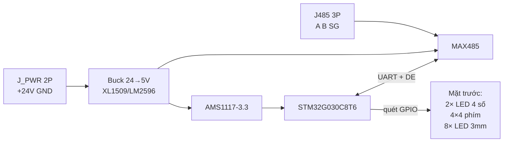

# Sơ đồ nguyên lý — Panel Keyboard RS485

## 1. Khối hệ thống



## 2. Bố trí PCB & phím

- **Mặt trên:** toàn bộ chip và SMD, stencil một lần. **Mặt dưới:** chỉ phím / LED / 7-seg. Ba vùng 24V / buck / MCU ở cột phải (`PCB_LAYOUT.md`, `CHONG_PHIM_MA.md`).
- Ma trận: **RK/RC 100Ω** sát GPIO, **RPK 10k** kéo cột lên +3V3; firmware debounce, một phím một lúc.

## 3. Nguồn (24 V tủ điện) — có lọc & clamp chống nhiễu

Chi tiết review: `docs/CHONG_NHIEM_EMC.md`.

```
Tham chiếu: fiberboard/pcb/PWR_24V_PROTECT_BUCK_GUIDE.txt (mức 1 — VFD/EMI).

J_PWR +24V ── F1 PPTC ── L2 CM (2 dây + và return) ── VIN_PROTECT
VIN_PROTECT: RV1 MOV || TVS1 SMAJ28A || C19/C15 || Q17 AO4407A + R17
J_PWR GND ── L2 return ── GND_PWR

Sau Q17: C4 1000µF → +24V → XL1509 U4 (C16 10µF + C17 100nF sát chân VIN)
Buck: D8 SS34, L1 47µH → +5V_RAW (C2 220µF + C5) ── FB2 ── +5V (C22) ── FB5V → +5V_LED

GND_PWR ── NT1 ── GND (logic / MCU / tụ 5V/3V3)

+5V ── AMS1117 ── +3V3_LDO (C3 22µF + C18 100nF sát chân ra) ── FB1 ── +3V3 ── CVDD1 100nF sát VDD STM32

STM32G030C8T6 LQFP-48: VDD/VDDA chân 6, VSS chân 7, 100nF. VBAT chân 4 và VREF+ chân 5 nối +3V3. NRST 10k→3V3 + 100nF→GND. PA14 là SWCLK và BOOT0, pull-down nội.
```

| Net | Mô tả |
|-----|--------|
| `+24V_IN` | Tủ → F1 |
| `+24V` | Sau Q17, vào buck |
| `GND_PWR` | Return 24V / switching (star qua NT1) |
| `GND` | Logic / MCU / RS485 signal GND |
| `+5V` | MAX485, nguồn anode 7-seg (`+5V_LED`) |
| `+3V3` | STM32 |

MAX485 dùng 5 V, IO chịu được mức 3.3 V.

## 3. STM32G030C8T6 + HT16K33A

**U6 HT16K33A** quét 8 chữ số và 8 LED trạng thái trên rail **+5V_LED**. STM32 chỉ nối I2C: **PA9 = SCL**, **PA10 = SDA**, kéo lên +5V_LED bằng **4,7 kΩ** vì VIH của chip là 0,7×5 V. Địa chỉ **0x70**. Các chân GPIO từng dùng cho segment, digit và LED để trống.

| Chức năng | Chân symbol | GPIO |
|-----------|-------------|------|
| DE / TX / RX | 12 / 13 / 14 | PA1 / PA2 / PA3 |
| I2C SCL / SDA | 29 / 32 | PA9 / PA10 |
| Hàng phím | 42–45 | PB3–PB6 |
| Cột phím | 46–48, 41 | PB7–PB9, PD3 |
| SWD | 35 / 36 | PA13 / PA14 |

## 4. Hiển thị 7 đoạn (2 × 4 digit, 0.56", DIP)

Tám LED 7 thanh **common cathode**. HT16K33A nối thẳng, không điện trở nối tiếp (datasheet: ROW ra panel).

| Net | Chân U6 | Ý nghĩa |
|-----|---------|---------|
| SEG1–SEG8 | ROW0–ROW7 (chân 25…18) | a, b, c, d, e, f, g, dp |
| GRID_1–GRID_8 | COM0–COM7 (chân 2…9) | cathode DS1–DS8 |
| LED_ROW | ROW8 (chân 17) | anode chung D10–D17 |

RAM: byte chẵn của mỗi COM là ROW0–ROW7, bit 0 = ROW0 = nét a. Byte lẻ bit 0 = ROW8 = LED trạng thái của digit đó. Chip quét khoảng 1/9.

## 5. Ma trận phím 4×4 (16 tact SMD 12×12)

STM32 quét ma trận 4×4. Kéo một hàng xuống GND, đọc cột (kéo lên 10k). Mức thấp = nhấn.

```
        C1    C2    C3    C4
R1      SW00  SW01  SW02  SW03
R2      SW04  SW05  SW06  SW07
R3      SW08  SW09  SW10  SW11
R4      SW12  SW13  SW14  SW15
```

RK/RC 100Ω nối tiếp sát GPIO, RPK 10k kéo cột lên +3V3. Firmware debounce, chỉ nhận một phím.

## 6. Eight LED trạng thái (0805, cột phải)

Anode nối **LED_ROW** (ROW8). Cathode D10 nối **GRID_1**, D11 nối **GRID_2**, … D17 nối **GRID_8**. LED sáng cùng lúc digit tương ứng được quét.

| LED | Màu (gợi ý) | GPIO | Chức năng decal (ví dụ) |
|-----|-------------|------|-------------------------|
| D1 | Xanh | PA9 | RUN |
| D2 | Đỏ | | STOP |
| D3 | Vàng | | FAULT |
| D4 | Xanh | | AUTO |
| D5 | Vàng | | MANUAL |
| D6 | Xanh | | READY |
| D7 | Vàng | | COMM |
| D8 | Đỏ | | ALARM |

Mỗi LED: **THT 3 mm** (PCB **D10–D17**), do **U6** quét. Cột **X = 79.5 mm**. Chi tiết `docs/MAT_BANG_CHUC_NANG_LED.md`.

## 7. RS485 (Modbus slave) — ESD, CM, failsafe

```
STM32 PA2 (TX) ── 47Ω ── MAX485 DI
STM32 PA3 (RX) ── 47Ω ── MAX485 RO
STM32 PA1 ── 0Ω ── ~RE + DE (nối chung); **10k pulldown GND** (mặc định RX)
MAX485 VCC ── 100nF sát chân; GND via stitch cạnh IC

MAX485 A,B ── [L485 CM choke] ── nets RS485_A, RS485_B
  RS485_A ── 560Ω ── +5V        (bias failsafe — idle high A)
  RS485_B ── 560Ω ── GND        (bias failsafe — idle low B)
  RS485_A ──┬── [JTERM: 120Ω] ──┬── RS485_B   (jumper/solder, node cuối bus)
            └── [TVS2 SM712] ── J485 pin1 A, pin2 B, pin3 SG
```

**Không** dùng 470Ω trên UART (edge quá chậm / lỗi Modbus tốc cao). **Không** đặt cap lớn trực tiếp A–B ngoài termination.

Giắc cắm rút trên PCB: **J485 = Degson 2EDG-5.08** (socket **2EDGVC-5.08-03P**). Chi tiết cáp → `docs/CAP_VA_GIAC.md`.

| J_PWR 2P | J485 3P |
|----------|---------|
| 1 +24V | 1 A |
| 2 GND | 2 B |
| | 3 SG |

## 8. Lập trình & reset

| Tín hiệu | Ghép chân |
|----------|-----------|
| SWDIO | PA13 |
| SWCLK | PA14 |
| NRST | 10k → 3V3, nút reset optional mặt trên |
| BOOT0 | PA14, pull-down nội (cùng chân SWCLK) — không gắn R |

Header 1.27 mm 4-pin SWD **mặt trên**, cùng phía với STM32.

## 9. Netlist tóm tắt (cho ERC/DRC)

```
+24V, GND, +5V, +5V_LED, +3V3, +3V3_ANA
UART_TX, UART_RX, RS485_DE
RS485_A, RS485_B
SEG1..SEG8, GRID_1..GRID_8
ROW1..ROW4, COL1..COL4
LED_1..LED_8
```

## 11. EMC — checklist linh kiện (cross-ref BOM)

| Ref | Value | Vị trí |
|-----|-------|--------|
| F1 | MF-MSMF350 | PPTC |
| L2 | ACM2012-201 | CM sau F1 |
| RV1 | 14D390K | MOV tại VIN_PROTECT |
| TVS1 | SMAJ28A | TVS nhanh |
| Q17 | AO4407A | Chống cực ngược |
| C4 | 1000µF | Bulk 24V (mức 1) |
| FB2/C22 | BLM21PG121 + 220µF | Rail +5V |
| FB1/CVDD1 | BLM21PG121 + 100nF | +3V3, tụ sát chân VDD |
| NT1 | NetTie | GND_PWR ↔ GND |
| FB5V, FB33 | 600Ω@100MHz | 5V→LED driver; 3V3→VDDA |
| L485 | CM choke RS485 | Giữa U3 và J1 |
| TVS2 | SM712 | Sát J485 A/B |
| Rbias | 560Ω ×2 | Failsafe A/B |
| JTERM | 120Ω + jumper | Termination |
| U6 | HT16K33A | Quét 7-seg và LED trạng thái |
| RSCL, RSDA | 4.7k | Kéo I2C lên +5V_LED |
| R47 ×2 | 47Ω | UART DI/RO |

## 10. Sơ đồ ASCII một trang

```
                    +24V --[F1][TVS][Q17][C4]-- XL1509 --+5V--[FB5V]-- +5V_LED U6
                    GND_PWR -- NT1 -- GND (logic) ===================|
                    +5V ---------------- MAX485 / AMS1117 --> +3V3 --[FB]-- VDDA
  J485 A/B/SG <-- SM712 <-- CM choke <-- (bias 560R) <-- MAX485 <-- UART 47R (STM32)
                           DE/~RE + 10k pulldown

  STM32 PA9/PA10 I2C -- 4.7k -- HT16K33A --> SEG + GRID + LED_ROW
  STM32 ROW/COL ------------------> 4x4 tact
```
