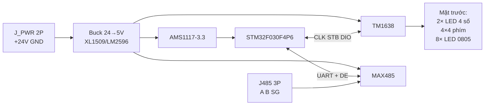

# Sơ đồ nguyên lý — Panel Keyboard RS485

## 1. Khối hệ thống



## 2. Bố trí PCB & phím

- **Mặt trước:** phím / LED / 7-seg **THT**; **mặt sau:** SMD một lần stencil; 3 vùng 24V / buck / MCU + khe cách (`PCB_LAYOUT.md`, `CHONG_PHIM_MA.md`).
- Ma trận: **RK/RC 100Ω** + **CK/CC 100nF** tại TM1638; firmware debounce.

## 3. Nguồn (24 V tủ điện) — có lọc & clamp chống nhiễu

Chi tiết review: `docs/CHONG_NHIEM_EMC.md`.

```
Tham chiếu: fiberboard/pcb/PWR_24V_PROTECT_BUCK_GUIDE.txt (mức 1 — VFD/EMI).

J_PWR +24V ── F1 PPTC ── L2 CM (2 dây + và return) ── VIN_PROTECT
VIN_PROTECT: RV1 MOV || TVS1 SMAJ28A || C19/C15 || Q12 AO4407A + R17
J_PWR GND ── L2 return ── GND_PWR

Sau Q12: C4 1000µF + C14 → +24V → XL1509 U4 (C16/C17); GND tab U4 → GND_PWR
Buck: D8 SS34, L1 47µH → +5V_RAW (C2 220µF + C5) ── FB2 ── +5V (C22) ── FB5V → +5V_LED

GND_PWR ── NT1 ── GND (logic / MCU / tụ 5V/3V3)

+5V ── AMS1117 ── +3V3_LDO (C3/C18) ── FB1 ── +3V3 (C21, CVDDA) ── STM32

STM32: 100nF mỗi VDD; NRST 10k→3V3 + 100nF→GND; BOOT0 10k→GND
```

| Net | Mô tả |
|-----|--------|
| `+24V_IN` | Tủ → F1 |
| `+24V` | Sau Q12, vào buck |
| `GND_PWR` | Return 24V / switching (star qua NT1) |
| `GND` | Logic / MCU / RS485 signal GND |
| `+5V` | TM1638, hiển thị, RS485 |
| `+3V3` | STM32 |

**STM32**: bộ chia 3V3/5V trên DIO TM1638 và UART MAX485 — MAX485 dùng 5 V nhưng IO 3.3 V compatible; nếu dùng SP485E 3.3 V thì có thể cấp 3V3.

## 3. Giao tiếp STM32 ↔ TM1638 (3 dây)

| Tín hiệu | STM32 (đề xuất) | TM1638 | Ghi chú |
|----------|-----------------|--------|---------|
| CLK | **PA4** → **R33 33Ω** | CLK (pin 17) | Gói **TSSOP-20** không có PB3–PB5; giảm ringing |
| STB | **PA5** → **R33 33Ω** | STB (pin 16) | Chip select / latch |
| DIO | **PA6** → **R33 33Ω** | DIO (pin 15) | **4.7k pull-up 3V3**; open-drain |

TM1638 VCC: 100nF + 10µF sát chân; nối **5V_LED** sau **FB5V** (tách ripple buck khỏi MCU).

Firmware: bit-bang hoặc SPI-like theo datasheet TM1638.

## 4. Hiển thị 7 đoạn (2 × 4 digit, 0.56", DIP)

Hai module **common cathode** (typical TM1638 wiring), segment song song, grid riêng:

| TM1638 | Module 1 (Target / Cài đặt) | Module 2 (Actual / Thực tế) |
|--------|----------------------------|-----------------------------|
| SEG1–SEG8 | a,b,c,d,e,f,g,dp (cả 2 module) | cùng bus segment |
| GRID1–GRID4 | Digit 1–4 module trên | — |
| GRID5–GRID8 | — | Digit 1–4 module dưới |

Điện trở 220 Ω–470 Ω serial trên segment **nếu** module không có sẵn (nhiều module TM1638 đã tích hợp; module DIP thường cần R per segment hoặc per digit — kiểm tra datasheet module mua).

## 5. Ma trận phím 4×4 (16 tact SMD 12×12)

TM1638 quét phím nội bộ; mắt xích 16 nút vào 8 dòng quét × 2 mức (chuẩn module TM1638):

```
        C1    C2    C3    C4
R1      SW00  SW01  SW02  SW03
R2      SW04  SW05  SW06  SW07
R3      SW08  SW09  SW10  SW11
R4      SW12  SW13  SW14  SW15
```

Ghép chân TM1638 (key matrix, datasheet Table "Key Scan"):
- Hàng quét: **KS1–KS8** (pins 1–8) — dùng 4 hàng cho 4×4, 4 hàng còn lại NC hoặc dự phòng.
- Cột: nối qua diode / layout chuẩn TM1638 (tham khảo PCB module TM1638 16-key).

*Trên PCB thực tế: bắt chước routing matrix của [TM1638 demo board] — 16 switch nối giữa KSx và grid/segment key inputs.*

## 6. Eight LED trạng thái (0805, cột phải)

TM1638 lái thêm 8 LED bằng cặp **GRID + SEG** (hoặc segment as GPIO sink):

| LED | Màu (gợi ý) | TM1638 drive | Chức năng decal (ví dụ) |
|-----|-------------|--------------|-------------------------|
| D1 | Xanh | GRID× + SEG× | RUN |
| D2 | Đỏ | | STOP |
| D3 | Vàng | | FAULT |
| D4 | Xanh | | AUTO |
| D5 | Vàng | | MANUAL |
| D6 | Xanh | | READY |
| D7 | Vàng | | COMM |
| D8 | Đỏ | | ALARM |

Mỗi LED: **THT 3 mm** (PCB **D10–D17**), serial **1 kΩ** trên B.Cu. Cột phải **X = 89.5 mm**, D10 tại **Y = 16** (sát cạnh trên bản vẽ KiCad, Y nhỏ). Chi tiết `docs/MAT_BANG_CHUC_NANG_LED.md`.

## 7. RS485 (Modbus slave) — ESD, CM, failsafe

```
STM32 PA2 (TX) ── 47Ω ── MAX485 DI
STM32 PA3 (RX) ── 47Ω ── MAX485 RO
STM32 PA1 ── 0Ω ── ~RE + DE (nối chung); **10k pulldown GND** (mặc định RX)
MAX485 VCC ── 100nF sát chân; GND via stitch cạnh IC

MAX485 A,B ── [L485 CM choke] ── nets RS485_A, RS485_B
  RS485_A ── 560Ω ── +5V        (bias failsafe — idle high A)
  RS485_B ── 560Ω ── GND        (bias failsafe — idle low B)
  RS485_A ──┬── [JTERM: 120Ω] ──┬── RS485_B   (jumper/solder, node cuối bus)
            └── [TVS2 SM712] ── J485 pin1 A, pin2 B, pin3 SG
```

**Không** dùng 470Ω trên UART (edge quá chậm / lỗi Modbus tốc cao). **Không** đặt cap lớn trực tiếp A–B ngoài termination.

Giắc cắm rút trên PCB: **J485 = Degson 2EDG-5.08** (socket **2EDGVC-5.08-03P**). Chi tiết cáp → `docs/CAP_VA_GIAC.md`.

| J_PWR 2P | J485 3P |
|----------|---------|
| 1 +24V | 1 A |
| 2 GND | 2 B |
| | 3 SG |

## 8. Lập trình & reset

| Tín hiệu | Ghép chân |
|----------|-----------|
| SWDIO | PA13 |
| SWCLK | PA14 |
| NRST | 10k → 3V3, nút reset optional mặt sau |
| BOOT0 | 10k → GND |

Header 1.27 mm 4-pin SWD **bottom**, không lộ mặt trước.

## 9. Netlist tóm tắt (cho ERC/DRC)

```
+24V, GND, +5V, +5V_LED, +3V3, +3V3_ANA
UART_TX, UART_RX, RS485_DE
RS485_A, RS485_B
TM1638_CLK, TM1638_STB, TM1638_DIO
SEG1..SEG8, GRID1..GRID8
KS1..KS8 (key matrix)
```

## 11. EMC — checklist linh kiện (cross-ref BOM)

| Ref | Value | Vị trí |
|-----|-------|--------|
| F1 | MF-MSMF350 | PPTC |
| L2 | ACM2012-201 | CM sau F1 |
| RV1 | 14D390K | MOV tại VIN_PROTECT |
| TVS1 | SMAJ28A | TVS nhanh |
| Q12 | AO4407A | Chống cực ngược |
| C4 | 1000µF | Bulk 24V (mức 1) |
| FB2/C22 | BLM21PG121 + 220µF | Rail +5V |
| FB1/C21 | BLM21PG121 + 100nF | Rail +3V3 |
| NT1 | NetTie | GND_PWR ↔ GND |
| FB5V, FB33 | 600Ω@100MHz | 5V→LED driver; 3V3→VDDA |
| L485 | CM choke RS485 | Giữa U3 và J1 |
| TVS2 | SM712 | Sát J485 A/B |
| Rbias | 560Ω ×2 | Failsafe A/B |
| JTERM | 120Ω + jumper | Termination |
| R33 ×3 | 33Ω | TM1638 bus |
| R47 ×2 | 47Ω | UART DI/RO |

## 10. Sơ đồ ASCII một trang

```
                    +24V --[F1][TVS][Q12][C4]-- XL1509 --+5V--[FB5V]-- TM1638 / LED
                    GND_PWR -- NT1 -- GND (logic) ===================|
                    +5V ---------------- MAX485 / AMS1117 --> +3V3 --[FB]-- VDDA
  J485 A/B/SG <-- SM712 <-- CM choke <-- (bias 560R) <-- MAX485 <-- UART 47R (STM32)
                           DE/~RE + 10k pulldown

  STM32 PB3/PB4/PB5 <===========> TM1638 CLK/STB/DIO
  TM1638 SEG* ========> 2x LED 4-digit (parallel seg)
  TM1638 GRID1-4/5-8 => digits
  TM1638 matrix ======> 4x4 Tact switches
  TM1638 GRID/SEG =====> 8x LED 0805 + 1k
```
